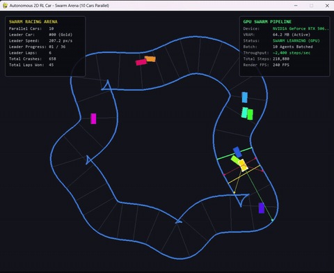
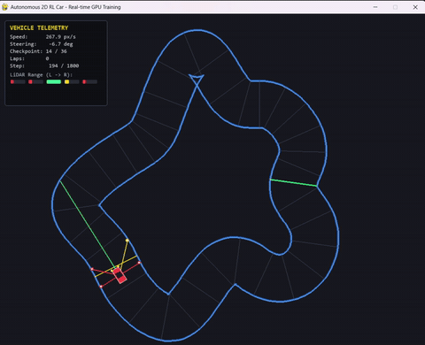

# 🏎️ Autonomous 2D RL Car (Pymunk, Pygame & Stable-Baselines3)

[](https://www.python.org/downloads/)
[](https://gymnasium.farama.org/)
[](http://www.pymunk.org/)
[](https://www.pygame.org/)
[](https://stable-baselines3.readthedocs.io/)
[](https://pytorch.org/)
[](LICENSE)

An end-to-end, high-performance Reinforcement Learning platform for autonomous racecar control on procedurally generated racetracks. Built with **Gymnasium**, **Pymunk 2D Rigid-Body Physics**, **Pygame**, and **Stable-Baselines3 (PPO)** with support for massive GPU-accelerated parallel swarm simulations.

---

## 📹 Video Demonstrations

### 1. Swarm Reinforcement Learning Training (Multi-Agent Fleet Exploration)
Watch the swarm training pipeline with hundreds of autonomous cars exploring trajectories across procedural tracks simultaneously:

> *Local repository video:* 


---

### 2. Autonomous Policy Evaluation & Testing
Trained PPO agent navigating complex turns and completing laps smoothly on unseen procedural tracks:

> *Local repository video:* 



---

## ✨ Key Features

- **Realistic 2D Tire Physics (`Pymunk`)**: Non-linear lateral grip damping and friction modeling to avoid unrealistic ice-skating dynamics while preserving drift mechanics.
- **Infinite Procedural Racetracks**: Procedural track generation using cubic periodic B-splines over randomized polar control points with inner/outer wall physics colliders and progressive checkpoint gates.
- **5-Ray LiDAR Sensor Array**: High-frequency raycasting measuring distances to track boundaries at $\{-90^\circ, -45^\circ, 0^\circ, 45^\circ, 90^\circ\}$.
- **Massive Swarm Training Arena**: Run 10 to 100+ parallel cars in the same interactive visual arena with independent collision respawns, spark particle effects, and leader tracking.
- **Gymnasium MDP Architecture**: Clean state & action normalization, dense reward formulation, and native compatibility with Stable-Baselines3 algorithms.
- **Interactive Pygame Visualizer**: Real-time HUD telemetry, speed control (FPS adjustment), visualization toggling for hyper-speed background computation, track regeneration on the fly, and manual model checkpointing.

---

## 🏛️ System Architecture

```
                      +---------------------------------------+
                      |       Procedural Track Generator      |
                      |   (Periodic B-Splines & Checkpoints)  |
                      +-------------------+-------------------+
                                          |
                                          v
+------------------+         +------------+------------+         +---------------------+
| PPO Agent (SB3)  | <====== |  RaycastCarEnv (Gym)    | ======> |   Pygame Renderer   |
| (MlpPolicy: 7D)  | actions |  - Pymunk 2D Physics    | frames  |   - Laser Raycasts  |
|                  | ======> |  - 5-Ray LiDAR Sensors  |         |   - Telemetry HUD   |
+------------------+         +-------------------------+         +---------------------+
```

### 1. Gymnasium MDP Formulation

- **Observation Space**: `Box(low=0.0, high=1.0, shape=(7,), dtype=np.float32)`
  $$\mathbf{s} = [d_{-90^\circ}, d_{-45^\circ}, d_{0^\circ}, d_{+45^\circ}, d_{+90^\circ}, v_{\text{norm}}, \delta_{\text{norm}}]$$
  - $d_\theta$: Normalized LiDAR ray distances ($0.0 \dots 1.0$)
  - $v_{\text{norm}}$: Normalized linear velocity
  - $\delta_{\text{norm}}$: Normalized angular orientation relative to next track checkpoint
- **Action Space**: `Box(low=-1.0, high=1.0, shape=(2,), dtype=np.float32)`
  - Continuous action vector: $[\text{Steering } (-1.0 \dots 1.0), \text{Throttle / Brake } (-1.0 \dots 1.0)]$
- **Reward Shaping**:
  - **Forward Progress**: Velocity projection along track centerline vector ($v \cdot \hat{u}_{\text{tangent}}$).
  - **Checkpoint Progression**: $+8.0$ reward per traversed checkpoint gate.
  - **Lap Completion**: $+30.0$ bonus per full lap completed.
  - **Survival Bonus**: $+0.05$ per step alive to encourage continuous driving.
  - **Collision Penalty**: $-100.0$ and immediate episode termination on wall impact.
  - **Reverse Penalty**: $-0.5$ when driving against track direction.

---

## 🚀 Installation & Setup

### 1. Clone Repository & Setup Virtual Environment
```powershell
# Clone repository
git clone https://github.com/your-username/RL_Car.git
cd RL_Car

# Create virtual environment
python -m venv venv

# Activate virtual environment
# Windows (PowerShell):
.\venv\Scripts\Activate.ps1
# Linux / macOS:
# source venv/bin/activate
```

### 2. Install Dependencies
```powershell
pip install -r requirements.txt
```

---

## 🎮 Usage Guide

### 1. Manual Driving Test (Physics & Controls Check)
Verify physics simulation, track generation, and LiDAR sensors using keyboard controls:
```powershell
python manual_control.py
```
- **W / Up Arrow**: Throttle
- **S / Down Arrow**: Brake / Reverse
- **A / Left Arrow**: Steer Left
- **D / Right Arrow**: Steer Right
- **R**: Generate a new procedural track
- **ESC**: Exit visualizer

---

### 2. Swarm Multi-Car Training (Recommended)
Train parallel cars in a single visual simulation arena with real-time swarm dynamics:
```powershell
python train_swarm.py --num-cars 50 --device cuda --fps 90
```
- **Leader Car**: Highlighted in **glowing gold** with active LiDAR beams.
- **Swarm Fleet**: Color-coded cars exploring varied trajectory lines.
- **Independent Crashes**: Cars crashing into walls burst into spark particles and respawn at the start grid while the rest of the fleet continues uninterrupted.
- **Hotkeys**:
  - `[SPACE]`: Pause / resume simulation.
  - `[V]`: Toggle visualization on/off for maximum GPU training throughput.
  - `[UP / DOWN]`: Increase / decrease playback FPS.
  - `[S]`: Save checkpoint on demand.
  - `[ESC]`: Clean exit and save model.

---

### 3. Single-Car Real-Time Visual Training
Watch a single car learn navigation, turns, and obstacle avoidance step-by-step:
```powershell
python train_visual.py --device cuda --fps 60
```
- `[SPACE]`: Pause / resume simulation.
- `[V]`: Toggle visual rendering on/off.
- `[R]`: Regenerate procedural track immediately.
- `[S]`: Save manual checkpoint (`models/checkpoint_manual.zip`).
- `[ESC]`: Save checkpoint and exit.

---

### 4. Fast Headless GPU Training (Vectorized Environments)
Train headless at maximum throughput across vectorized Gym environments (up to ~1,100+ FPS):
```powershell
python train.py --device cuda --num-envs 8 --timesteps 500000
```

Monitor training live in TensorBoard:
```powershell
tensorboard --logdir logs
```

---

### 5. Policy Evaluation & Testing
Evaluate saved models on randomized tracks:
```powershell
python eval.py --model-path models/best_swarm_model.zip --episodes 10 --fps 60
```
- `[R]`: Regenerate a new track mid-evaluation.
- `[ESC]`: Quit evaluation.

---

## 📁 Repository Structure

```
RL_Car/
├── envs/
│   ├── car_env.py          # Gymnasium MDP environment with Pymunk physics
│   ├── track_generator.py  # Procedural spline track generation & checkpoints
│   └── swarm_env.py        # Multi-car swarm simulation environment
├── models/                 # Saved policy checkpoints (.zip)
├── logs/                   # TensorBoard training metrics & logs
├── ScreenShots/            # Training and evaluation demo videos
│   ├── Swarm_Training.mp4  # Swarm training demo recording
│   └── Testing.mp4         # Policy evaluation demo recording
├── manual_control.py       # Human playable keyboard drive test
├── train_swarm.py          # Swarm multi-car visual training script
├── train_visual.py         # Single-car visual training script
├── train.py                # Fast vectorized headless training script
├── eval.py                 # Policy evaluation and performance benchmark
├── requirements.txt        # Python package dependencies
└── README.md               # Project documentation
```

---

## 📈 Hyperparameters & PPO Settings

| Parameter | Value | Description |
|---|---|---|
| **Algorithm** | PPO (`stable_baselines3`) | Proximal Policy Optimization |
| **Policy** | `MlpPolicy` [64, 64] | Fully-connected multi-layer perceptron |
| **Learning Rate** | `3e-4` | Adam optimizer learning rate |
| **Clip Range** | `0.2` | PPO surrogate objective clipping factor |
| **Gamma ($\gamma$)** | `0.99` | Discount factor for future rewards |
| **GAE Lambda ($\lambda$)** | `0.95` | Generalized Advantage Estimation parameter |
| **Ent. Coefficient** | `0.01` | Entropy bonus coefficient for exploration |
| **Total Timesteps** | `250,000` - `500,000` | Recommended convergence range |

---

## 📜 License

This project is licensed under the [MIT License](LICENSE).
